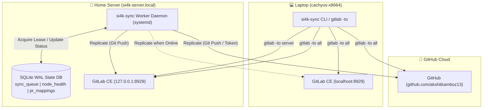

# 🚀 si4k.git-sync

> **Fault-Tolerant Tri-Node Git Replication & Distributed Sync Engine**  
> Connecting **Laptop GitLab** (Primary Source of Truth), **Home Server GitLab** (Persistent Mirror & Runner), and **GitHub** (Public Portfolio & Off-site Gateway).

---

## 🏛️ Architecture Overview



---

## ⚡ Core Principles

1. **Independent Destination Fault-Tolerance**:
   A failed push to one destination (e.g. laptop is sleeping) never blocks or unnecessarily repeats pushes to other destinations.
2. **Persistent Home Server Daemon**:
   The home server runs 24/7, keeping retry queues alive, recovering expired leases, and executing replication in the background.
3. **Atomic SQLite Leases**:
   Queue jobs use atomic conditional updates (`locked_by`, `locked_until`) with crash recovery and exponential retry backoff (30s, 60s, 120s, 240s, 480s ➔ dead-letter).
4. **Zero-Plaintext Secret Exposure**:
   Secrets are loaded exclusively via environment variables or protected `secrets.env` files (`chmod 600`).

---

## 🛠️ CLI Quick Reference

```bash
# Check queue status and node health
si4k-sync status

# Probe real-time network connectivity and latency to all 3 nodes
si4k-sync health

# Enqueue a replication task
si4k-sync enqueue --project PC-Papa --source server_gitlab --target github --branch main --sha <commit_hash>

# Run worker daemon (foreground)
si4k-sync worker

# Run single iteration and exit
si4k-sync worker --once
```

---

## 🏰 Deployment on Home Server

```bash
# 1. Clone repository to /home/si4k/si4k.git-sync
git clone git@gitlab-server:akshitkamboz13/si4k.git-sync.git /home/si4k/si4k.git-sync

# 2. Configure secrets
mkdir -p /home/si4k/.config/si4k-git-sync
cp /home/si4k/si4k.git-sync/systemd/secrets.env.example /home/si4k/.config/si4k-git-sync/secrets.env
chmod 600 /home/si4k/.config/si4k-git-sync/secrets.env

# 3. Install systemd service
sudo cp /home/si4k/si4k.git-sync/systemd/si4k-git-sync.service /etc/systemd/system/
sudo systemctl daemon-reload
sudo systemctl enable --now si4k-git-sync.service
```
